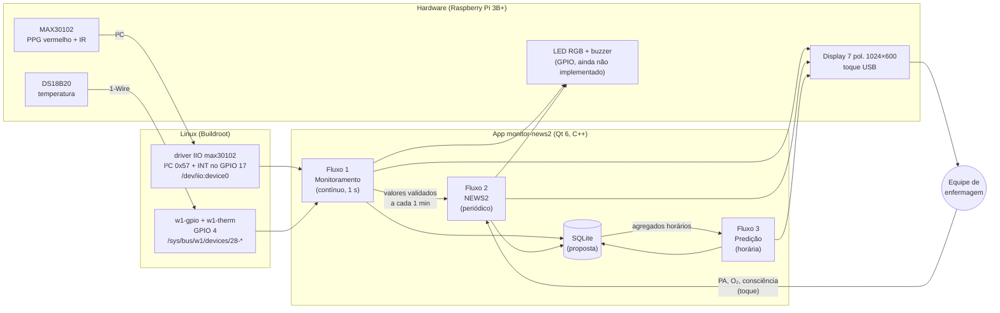
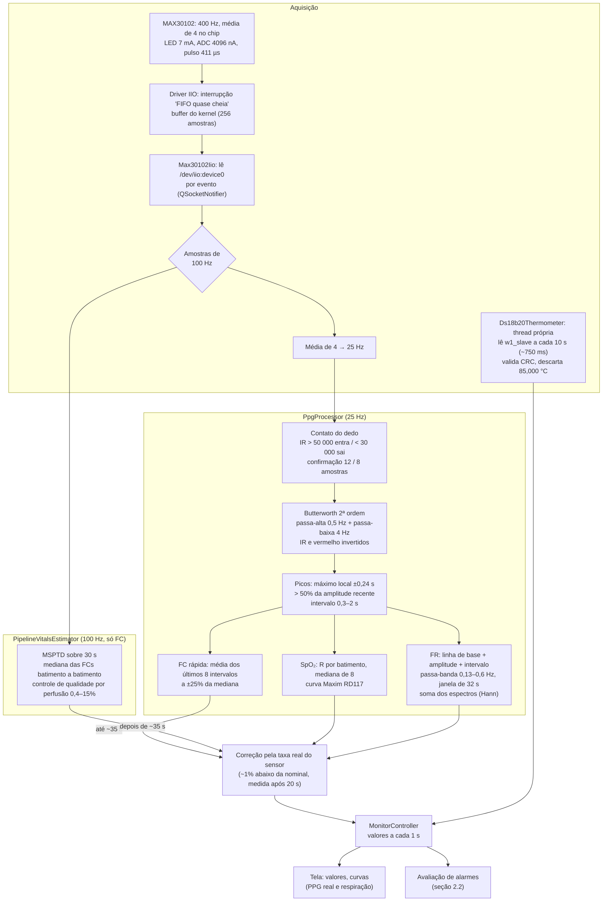
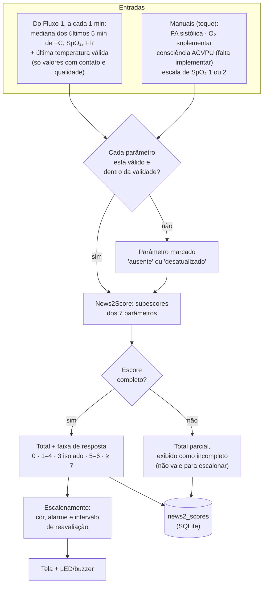
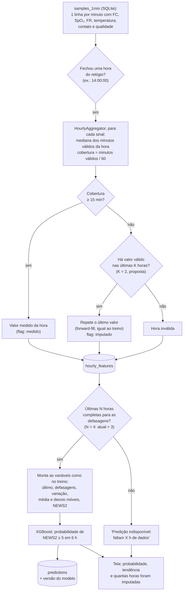

# Fluxos do sistema: monitoramento, NEWS2 e predição

Detalha o rascunho dos três fluxos do monitor: o que já existe no código, as decisões que ainda
precisam ser tomadas (com a proposta e a referência de cada uma) e o que falta definir. Os
fluxogramas usam Mermaid, que o GitHub renderiza.

Status: **proposta para discussão no grupo e com o orientador**. Onde está escrito "proposta", o
valor ainda não foi decidido.

## 1. Visão geral

| Fluxo | Pergunta que responde | Cadência | Saída |
|---|---|---|---|
| 1. Monitoramento | Como o paciente está **agora**? | Contínuo; tela a cada 1 s | Valores, curvas e alarmes fisiológicos e técnicos |
| 2. NEWS2 | Qual o **risco clínico** atual pelo protocolo? | Proposta: a cada 1 min | Escore, faixa de resposta e escalonamento |
| 3. Predição | O NEWS2 vai chegar a **≥ 5 nas próximas 6 h**? | A cada hora fechada | Probabilidade e tendência |

## 2. Fluxo 1: monitoramento

### 2.1 Aquisição e processamento

| Classe | Comunicação | Cálculo / responsabilidade |
|---|---|---|
| `Max30102Iio` | I²C via driver IIO, INT no GPIO 17, `/dev/iio:device0` | Lê as amostras de 100 Hz e gera também as de 25 Hz |
| `Max30102` (alternativa) | I²C direto via `/dev/i2c-1` (polling a 40 ms) | Mesmo papel, sem driver do kernel |
| `PpgProcessor` | — | Contato, filtros, picos, FC rápida, SpO₂, FR, curvas da tela |
| `PipelineVitalsEstimator` | — | FC pelo MSPTD (código do `ppg-pipeline`) a 100 Hz |
| `Ds18b20Thermometer` | 1-Wire via `w1-therm`, GPIO 4 | Temperatura a cada 10 s, numa thread própria |
| `Max30102VitalSignsSource` | — | Junta tudo, corrige pela taxa real e publica a cada 1 s |
| `MonitorController` | — | Estado da tela, alarmes, NEWS2, sessão do paciente |

A comparação dos métodos de cálculo está em [comparativo.md](../comparativo.md).

### 2.2 Alarmes do monitoramento (proposta)

**Proposta:** alinhar os limites de alarme às faixas de **3 pontos** do NEWS2. Uma única variável
com 3 pontos já pede resposta urgente pelo protocolo do RCP [1], então o alarme sinaliza na hora
o que o NEWS2 vai pontuar. Isso exige um **atraso de persistência**: o valor precisa ficar fora
do limite por um tempo antes do alarme tocar, porque artefatos curtos são a principal fonte de
falsos alarmes [3][4][5].

| Sinal | Alarme alto (vermelho) | Alerta (amarelo) | Atraso proposto | Referência |
|---|---|---|---|---|
| FC | ≤ 40 ou ≥ 131 bpm | 41–50 ou 111–130 bpm | 15 s | Faixas do NEWS2 [1]; atraso [4][5] |
| SpO₂ (escala 1) | ≤ 91% | 92–93% | 15 s | Faixas do NEWS2 [1]; atraso [4][5] |
| FR | ≤ 8 ou ≥ 25 irpm | 21–24 irpm | 60 s | Faixas do NEWS2 [1]; a FR já é média de 32 s |
| Temperatura | ≤ 35,0 °C | ≥ 39,1 °C | 5 min | Faixas do NEWS2 [1]; o sensor leva ~1,5 min para aquecer |
| Dedo fora do sensor | — | técnico | ~0,3 s (8 amostras) | Já implementado. Avaliar 10 s para não alarmar a cada ajuste do dedo |
| Sensor sem resposta | — | técnico | 3 s | Já implementado (vigia do IIO) |
| Sem temperatura | — | técnico | 30 s | Proposta |

**Prioridades e sinalização:** seguir a IEC 60601-1-8 (alta = vermelho, média = amarelo, baixa =
ciano), que o app já usa. O silêncio deve ser temporário, nunca permanente; o app já faz isso
(`AlarmPolicy`).

**Alternativas a discutir:**

- **Limites mais permissivos, como em Taenzer et al. (2010)** [2]: SpO₂ < 80%, FC < 50 ou > 140,
  numa vigilância de enfermaria que reduziu eventos de resgate e transferências para UTI.
  Esses limites geram menos alarmes, mas avisam mais tarde.
- **Sem alarmes fisiológicos, só tendência**: Leenen et al. (2022) [6] mostraram ser viável na
  enfermaria, com a enfermagem revisando as tendências em horários fixos.
- **Limites ajustáveis por paciente**: a AACN recomenda individualizar limites e atrasos [3].

## 3. Fluxo 2: NEWS2

### 3.1 Decisões

| Decisão | Proposta | Justificativa e referência |
|---|---|---|
| Intervalo de cálculo | **A cada 1 min**, sobre a **mediana dos últimos 5 min** de cada sinal contínuo. Hoje o app recalcula a cada 30 s com o último valor. | O RCP define frequência **mínima** de observação para medição manual (12 h no escore 0, 4–6 h no 1–4, 1 h no 5–6, contínua no ≥ 7) [1]. Com sensor contínuo isso é decisão de projeto; a mediana de 5 min evita que um artefato mude o escore. |
| Registro "oficial" | Um escore por **hora cheia** no armazenamento, além do valor ao vivo | É a mesma grade horária do modelo de predição (seção 4) |
| Validade da PA, do O₂ e da consciência | Vale até a próxima medição, mas marcada **desatualizada** se passar do intervalo mínimo da faixa atual (ex.: > 1 h com escore ≥ 5) e pede nova medição | Mantém o escore coerente com o intervalo de reavaliação do RCP [1] |
| Escore incompleto | Exibir o total parcial e os parâmetros que faltam, **sem escalonar**. Não pode "aguardar" indefinidamente, como no rascunho. | Um escore parcial subestima o risco; mostrar o que falta direciona a enfermagem |
| Escala 2 de SpO₂ | A enfermagem marca, para pacientes com insuficiência respiratória hipercápnica (alvo de 88–92%) | Definida no NEWS2 [1]; o app já suporta |

## 4. Fluxo 3: predição

### 4.1 Como o modelo foi treinado (texto do TCC, etapa MP01)

- **Base:** Reyna et al., PhysioNet/CinC 2019 [7], com 40.336 pacientes e **uma linha por hora**.
  Quando há várias medições na mesma hora, a base usa a **mediana** delas [8].
- **Dados ausentes:** preenchidos com o último valor válido anterior, de forma causal e por paciente
  (*forward-fill*).
- **Variáveis:** último valor, defasagens das **3 horas anteriores**, variação, média e
  desvio-padrão móveis, mais o NEWS2 atual, a defasagem e a variação dele.
- **Alvo:** NEWS2 ≥ 5 nas próximas 6 h.

**Regra principal:** o equipamento precisa entregar ao modelo **o mesmo tipo de dado do treino**.
O sensor mede a cada segundo, mas o modelo aprendeu com medianas horárias e com o preenchimento
de lacunas pelo último valor. Se o equipamento usar outra agregação (ex.: média de 1 min ou valor
instantâneo), o modelo recebe dados de uma distribuição diferente da que aprendeu e perde
desempenho sem dar nenhum aviso.

### 4.2 Como manter a janela consistente quando faltam medições

| Decisão | Proposta | Justificativa e referência |
|---|---|---|
| Grade de tempo | Horas **do relógio** (14:00–15:00), não "60 min desde a última medição" | O medido segue alinhado com o treino mesmo com pausas; exige relógio certo (seção 5) |
| Agregação da hora | **Mediana** dos minutos válidos | Mesma regra da base de treino [8]; é robusta a artefatos |
| Cobertura mínima da hora | **≥ 15 min válidos** (proposta) | Abaixo disso a mediana representa mal a hora. O valor deve ser ajustado vendo quanto a predição muda na validação. |
| Hora sem dados | Repete o último valor (**forward-fill**) por até **K = 2 h** e marca como imputado | É o que o treino fez. Um limite de K evita "congelar" um paciente sem medição. |
| Além de K horas | Predição **indisponível**, com aviso na tela | Melhor não predizer do que predizer com dados velhos |
| Indicadores de ausência | Só se o modelo for **retreinado** com eles | Lipton et al. (2016) mostram que indicar a ausência melhora o modelo [9], mas o modelo atual não foi treinado com isso |
| Cadência | Uma predição por hora fechada | Coincide com a resolução do modelo |
| Execução do modelo | Exportar o XGBoost em JSON e percorrer as árvores em C++ (ou Python com numpy, que já está na imagem) | Custo desprezível; versionar o modelo junto com a predição |

### 4.3 Pergunta em aberto: a janela de 1 h

O rascunho diz que o modelo agora usa uma **janela de 1 h** (antes eram 6 h). O texto do TCC
descreve variáveis com **defasagens das 3 horas anteriores**, o que exige pelo menos **4 horas**
de histórico. É preciso confirmar com quem treinou o modelo:

1. "1 h" é o **tamanho da janela de entrada** (o modelo só olha a última hora) ou a **resolução** (uma linha por hora)?
2. As defasagens de 3 h continuam no modelo novo?
3. Quais variáveis exatas, e em que ordem, entram no modelo? Isso define o `HourlyAggregator`.

Se a entrada for só a última hora, o fluxo acima continua igual, com N = 1.

## 5. Armazenamento (proposta)

Hoje o histórico fica **só em memória** (`QVector` em `PatientSession`): um reboot ou queda de
energia apaga tudo, inclusive as horas de que a predição precisa. A proposta é SQLite, que já
está na imagem (Qt SQL + SQLite), no cartão SD, em modo WAL.

| Tabela | Conteúdo | Gravação | Retenção (proposta) |
|---|---|---|---|
| `samples_1min` | Mediana de cada minuto: FC, SpO₂, FR, temperatura, contato, qualidade | 1×/min | 72 h |
| `manual_entries` | PA, O₂, ACVPU, escala de SpO₂, quem registrou | A cada registro | Sessão do paciente |
| `news2_scores` | Total, subescores, completude | 1×/min | 72 h |
| `hourly_features` | Valores da hora, cobertura, flag medido/imputado | 1×/h | Sessão do paciente |
| `predictions` | Probabilidade, versão do modelo, horas imputadas | 1×/h | Sessão do paciente |
| `events` | Alarmes, silêncios, reconhecimentos, falhas de sensor | A cada evento | Sessão do paciente |

O sinal PPG bruto **não** é armazenado (25–100 amostras/s gastariam o SD), só os valores por
minuto. Para pesquisa, o gravador de bancada já existe (`software/bringup`).

## 6. O que ainda falta definir

Itens que o rascunho não cobre e que afetam a implementação ou o texto do TCC:

| # | Item | Por que importa | Situação |
|---|---|---|---|
| 1 | **Consciência (ACVPU)** | É o 7º parâmetro do NEWS2 e vale até 3 pontos [1]. O rascunho fala em "5 parâmetros". | Não implementado: precisa de entrada manual na tela |
| 2 | **Validade das entradas manuais** | PA, O₂ e ACVPU envelhecem; o escore precisa saber quando estão desatualizadas | Seção 3.1 (proposta) |
| 3 | **Persistência** | Reboot e queda de energia apagam o histórico | Seção 5 (proposta) |
| 4 | **Relógio** | A grade horária precisa de hora certa. O Pi **não tem RTC**: sem rede no boot, o relógio volta a 1969. | NTP já funciona com rede; avaliar um RTC (ex.: DS3231 no I²C) ou bloquear a predição até sincronizar |
| 5 | **Qualidade antes do NEWS2** | Valor com dedo se mexendo não pode entrar no escore | Parcial: contato e controle de qualidade existem; falta definir o critério por minuto |
| 6 | **LED e buzzer** | O alarme sonoro e visual ainda é simulado no console | Não implementado (`AlarmIndicator`) |
| 7 | **Limiar da predição** | Hoje é 50% fixo no código; deveria vir da curva de precisão e recall da validação | Definir com o resultado do modelo |
| 8 | **Exibição da incerteza** | Mostrar quantas horas foram imputadas e a versão do modelo | Proposta na seção 4.2 |
| 9 | **Calibração da SpO₂** | Os dois métodos diferem ~3 pontos, e 95% contra 96% muda o NEWS2 | Comparar com oxímetro comercial |
| 10 | **Local da temperatura** | Dedo ou pele ficam abaixo da temperatura central; o NEWS2 usa a corporal | Definir o local do sensor e, se preciso, um ajuste |
| 11 | **Validação da FR** | Falta referência: contagem manual de 60 s ou respiração ritmada | Montar o protocolo |
| 12 | **Sessão do paciente e privacidade** | Início e fim de monitoramento, identificação, LGPD se houver identificação | O app tem "plantão"; falta a identificação |
| 13 | **Recuperação de falhas** | O app pode cair: quem reinicia? E se o sensor travar na partida (falha do IIO)? | Vigia de 3 s existe; falta reiniciar o app automaticamente |
| 14 | **Desempenho e boot** | Tempo até o primeiro valor e o primeiro NEWS2 depois de ligar | Medir e documentar |

## 7. Referências

1. Royal College of Physicians. *National Early Warning Score (NEWS) 2*, 2017. Chart 4: resposta
   clínica por faixa de escore. <https://www.rcp.ac.uk/media/mrllczrj/news2-chart-4_clinical-response-to-news-trigger-thresholds_0.pdf>
   · relatório completo: <https://www.rcp.ac.uk/media/a4ibkkbf/news2-final-report_0_0.pdf>
2. Taenzer A. H. et al. Impact of pulse oximetry surveillance on rescue events and intensive care
   unit transfers. *Anesthesiology*, 112(2):282–287, 2010. <https://read.qxmd.com/read/20098128/impact-of-pulse-oximetry-surveillance-on-rescue-events-and-intensive-care-unit-transfers-a-before-and-after-concurrence-study>
   · limites usados (SpO₂ < 80%, FC < 50 / > 140): APSF Newsletter, 2012. <https://www.masimo.fr/siteassets/us/documents/pdf/apsf-newsletter-spring-2012.pdf>
3. American Association of Critical-Care Nurses. *Practice Alert: Managing Alarms in Acute Care
   Across the Life Span*, 2013 (individualizar limites e atrasos). Resumo: <https://www.psqh.com/news/new-aacn-practice-alert-aims-to-improve-patient-safety-minimize-alarm-fatigue/>
4. Welch J. An evidence-based approach to reduce nuisance alarms and alarm fatigue. *Biomedical
   Instrumentation & Technology* (AAMI Horizons), 2011. <https://www.aami.org/docs/default-source/foundation/alarms/bit/2011horizons_evidence_based.pdf>
   (autor ligado a fabricante; o efeito de 70% do atraso de 15 s é estimado)
5. Rheineck-Leyssius A. T., Kalkman C. J. Influence of pulse oximeter lower alarm limit on the
   incidence of hypoxaemia in the recovery room. *Br J Anaesth*, 1997. <https://researchinformation.umcutrecht.nl/en/publications/influence-of-pulse-oximeter-lower-alarm-limit-on-the-incidence-of/>
6. Leenen J. P. L. et al. Feasibility of wireless continuous monitoring of vital signs without
   using alarms on a general surgical ward. *PLOS ONE*, 2022. DOI 10.1371/journal.pone.0265435.
   <https://www.ncbi.nlm.nih.gov/pmc/articles/PMC8947816/>
7. Reyna M. A. et al. Early prediction of sepsis from clinical data: the PhysioNet/Computing in
   Cardiology Challenge 2019. *Critical Care Medicine*, 2020. <https://pmc.ncbi.nlm.nih.gov/articles/PMC6964870>
8. Reyna M. A., Clifford G. D. et al. Análise do Challenge 2019 (agregação horária pela mediana).
   <https://arxiv.org/pdf/2012.11013>
9. Lipton Z. C., Kale D. C., Wetzel R. Directly modeling missing data in sequences with RNNs:
   improved classification of clinical time series. *Machine Learning for Healthcare*, PMLR 56,
   2016. <https://proceedings.mlr.press/v56/Lipton16.html>
10. IEC 60601-1-8: requisitos gerais para sistemas de alarme em equipamentos eletromédicos
    (prioridades e sinalização). Norma paga; citar pela edição consultada.
